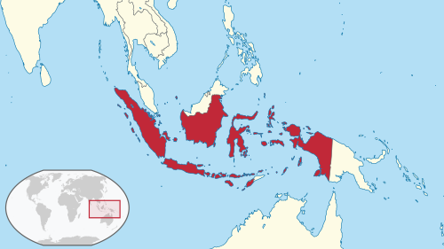
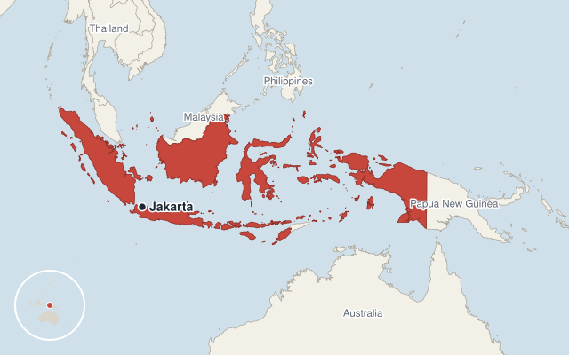

---
id    = "4edb30ed-ec6a-5e70-bea2-f4384d57dbf5"
model = "Basic"
tags  = ["asia", "southeast_asia", "sovereign_state", "map"]
---

## Front

What is highlighted on this map?

## Back

<b>Indonesia</b>

## Extra

More than 13,000 islands Highest point is Puncak Jaya

The world's largest archipelagic state, spread over Sumatra, Java, Sulawesi and parts of Borneo and New Guinea. Sea and air transport connect the islands.

<a href="https://en.wikipedia.org/wiki/Indonesia">Indonesia on Wikipedia</a>
