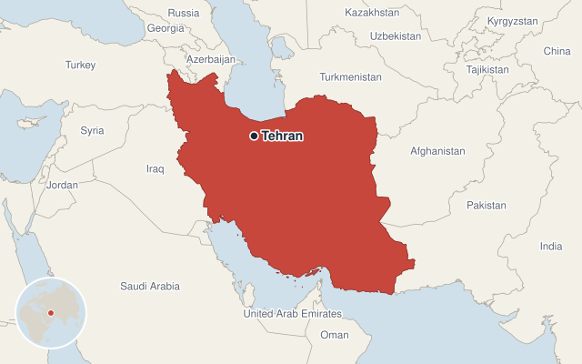

---
id    = "6c097890-1195-5abe-805a-945c24ffab34"
model = "Basic"
tags  = ["asia", "middle_east", "sovereign_state", "capital"]
---

## Front

What is the capital of <b>Iran</b>?

## Back

<b>Tehran</b>

## Extra

About 8.7 million people (2016) 1,179 m above sea level

Agha Mohammad Khan chose it as capital in 1786, for its proximity to Iran's Caucasus territories and to avoid rival factions. Air pollution, earthquakes and water scarcity have prompted relocation plans, none approved.

<a href="https://en.wikipedia.org/wiki/Tehran">Tehran on Wikipedia</a> <a href="https://en.wikipedia.org/wiki/Iran">Iran on Wikipedia</a>
