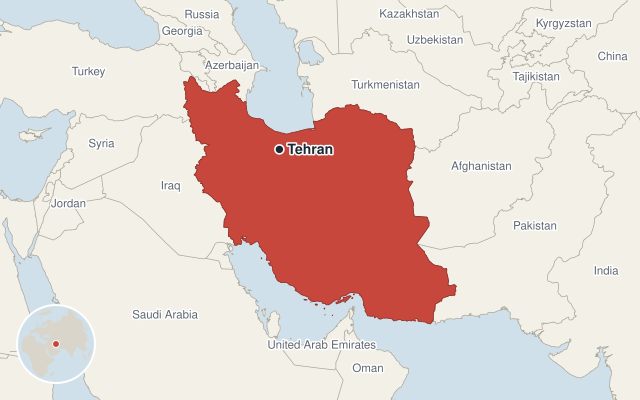

---
id    = "0aca2694-66f5-500e-b019-e8f0632a1f75"
model = "Basic"
tags  = ["asia", "middle_east", "sovereign_state", "country"]
---

## Front

<b>Tehran</b> is the capital of which country or territory?

## Back

<b>Iran</b>

## Extra

About 92 million people (2025) in 1.65 million km² Highest point is Damavand

Borders the Caspian Sea to the north and the Persian Gulf and Gulf of Oman to the south.

<a href="https://en.wikipedia.org/wiki/Iran">Iran on Wikipedia</a> <a href="https://en.wikipedia.org/wiki/Tehran">Tehran on Wikipedia</a>
