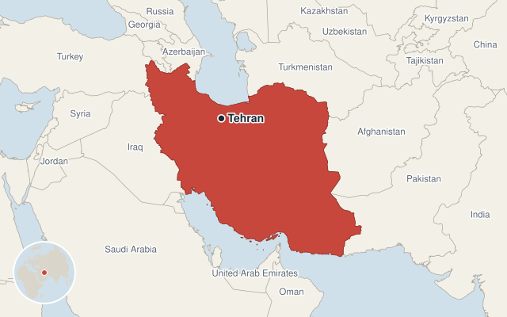

---
id    = "c95dfc59-21d0-5a0a-a1e2-bc49ccfbdc19"
model = "Basic"
tags  = ["asia", "middle_east", "sovereign_state", "flag"]
---

## Front

Whose flag is this?

## Back

<b>Iran</b>

## Extra

<a href="https://en.wikipedia.org/wiki/Flag_of_Iran">Flag of Iran on Wikipedia</a> <a href="https://en.wikipedia.org/wiki/Iran">Iran on Wikipedia</a>
