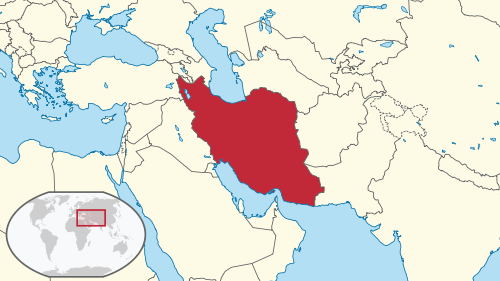
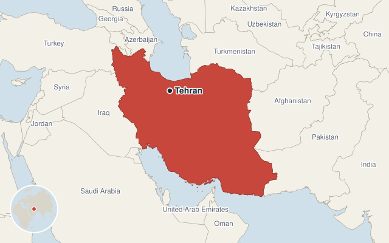

---
id    = "cbf7619b-f55a-58d0-ba15-e33311655da2"
model = "Basic"
tags  = ["asia", "middle_east", "sovereign_state", "map"]
---

## Front

What is highlighted on this map?

## Back

<b>Iran</b>

## Extra

Borders Iraq, Turkey, Azerbaijan, Armenia, Turkmenistan, Afghanistan and Pakistan

It has a Caspian Sea coast in the north and the Persian Gulf and Gulf of Oman in the south.

<a href="https://en.wikipedia.org/wiki/Iran">Iran on Wikipedia</a>
