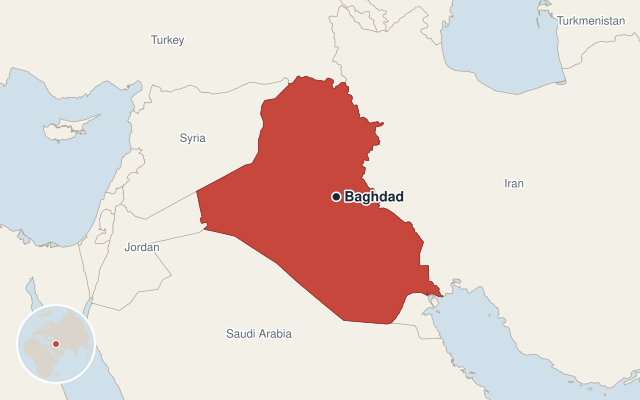

---
id    = "9e08a8f1-d488-5a47-a915-4f48827a236f"
model = "Basic"
tags  = ["asia", "middle_east", "sovereign_state", "capital"]
---

## Front

What is the capital of <b>Iraq</b>?

## Back

<b>Baghdad</b>

## Extra

<a href="https://en.wikipedia.org/wiki/Baghdad">Baghdad on Wikipedia</a> <a href="https://en.wikipedia.org/wiki/Iraq">Iraq on Wikipedia</a>
