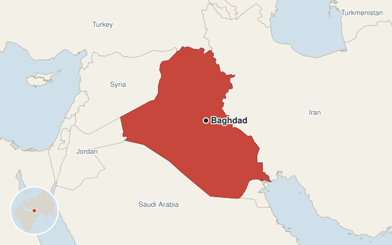

---
id    = "95df9d5a-036d-5c4d-80d0-da61f551cdb0"
model = "Basic"
tags  = ["asia", "middle_east", "sovereign_state", "country"]
---

## Front

<b>Baghdad</b> is the capital of which country or territory?

## Back

<b>Iraq</b>

## Extra

Over 46 million people in 438,317 km² Highest point is Cheekha Dar

Known as the cradle of civilisation: the fertile plains between the Tigris and Euphrates, called Mesopotamia, fostered Sumer, Akkad, Babylonia and Assyria.

<a href="https://en.wikipedia.org/wiki/Iraq">Iraq on Wikipedia</a> <a href="https://en.wikipedia.org/wiki/Baghdad">Baghdad on Wikipedia</a>
