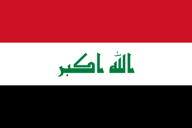
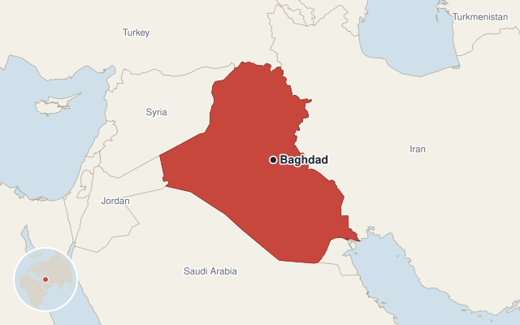

---
id    = "cb637a92-e333-5325-9031-02d29a8b6607"
model = "Basic"
tags  = ["asia", "middle_east", "sovereign_state", "flag"]
---

## Front

Whose flag is this?

## Back

<b>Iraq</b>

## Extra

Similar flags: Egypt (emblem instead of text), Yemen (no text)

<a href="https://en.wikipedia.org/wiki/Flag_of_Iraq">Flag of Iraq on Wikipedia</a> <a href="https://en.wikipedia.org/wiki/Iraq">Iraq on Wikipedia</a>
