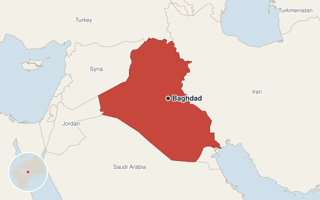
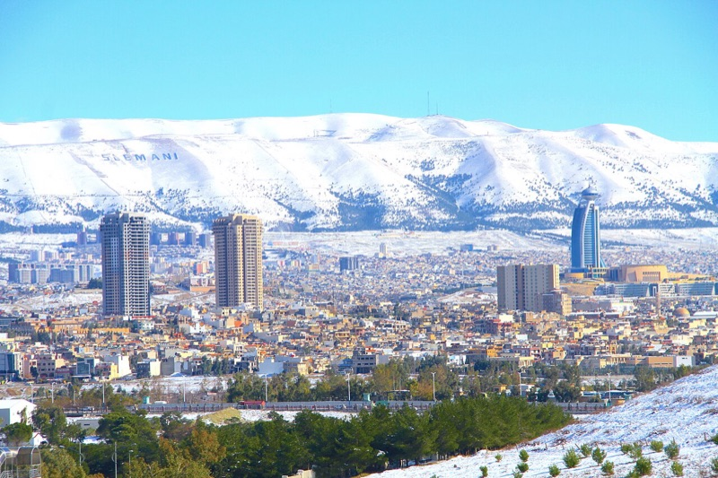

---
id    = "8a082068-1c72-52ea-bdb0-6f68e155e5ee"
model = "Basic"
tags  = ["asia", "middle_east", "sovereign_state", "map"]
---

## Front

What is highlighted on this map?

## Back

<b>Iraq</b>

## Extra

<i>Photo: Diyar Muhammed, CC BY-SA 4.0, via Wikimedia Commons</i>

Borders Turkey, Syria, Jordan, Saudi Arabia, Kuwait and Iran

The fertile plains lie between the Tigris and Euphrates rivers, with the Persian Gulf to the southeast.

<a href="https://en.wikipedia.org/wiki/Iraq">Iraq on Wikipedia</a>
