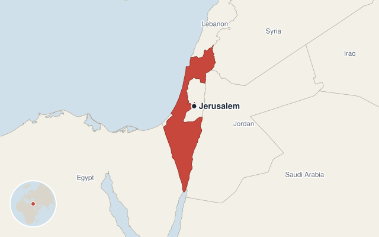

---
id    = "108f40a1-8066-58a2-86b9-2817cadc42bb"
model = "Basic"
tags  = ["asia", "mediterranean", "middle_east", "sovereign_state", "capital"]
---

## Front

What is the capital of <b>Israel</b>?

<i>Claimed and controlled</i>

## Back

<b>Jerusalem</b>

## Extra

About 1.05 million people (2024) 754 m above sea level

One of the oldest cities in the world, holy to Judaism, Christianity and Islam. Its status is contested: both Israel and Palestine claim it as their capital.

Disputed; claimed by Palestine.

<a href="https://en.wikipedia.org/wiki/Jerusalem">Jerusalem on Wikipedia</a> <a href="https://en.wikipedia.org/wiki/Israel">Israel on Wikipedia</a>
