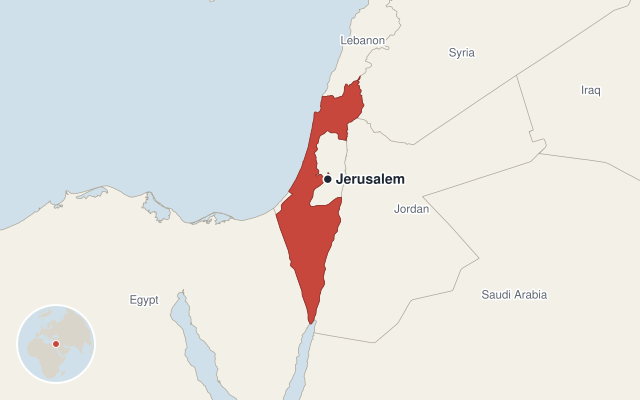

---
id    = "36318a47-3d1f-5137-b082-114e7d002d46"
model = "Basic"
tags  = ["asia", "mediterranean", "middle_east", "sovereign_state", "country"]
---

## Front

<b>Jerusalem</b> is the capital of which country or territory?

## Back

<b>Israel</b>

## Extra

Disputed; claimed by Palestine.

<a href="https://en.wikipedia.org/wiki/Israel">Israel on Wikipedia</a> <a href="https://en.wikipedia.org/wiki/Jerusalem">Jerusalem on Wikipedia</a>
