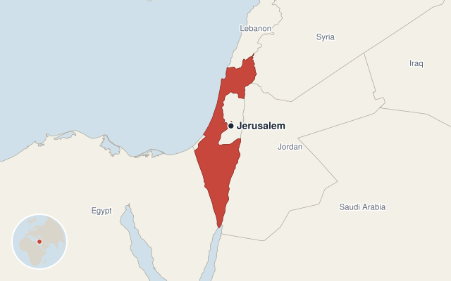

---
id    = "9b37d158-f2ab-564f-a168-afe23c43cd16"
model = "Basic"
tags  = ["asia", "mediterranean", "middle_east", "sovereign_state", "flag"]
---

## Front

Whose flag is this?

## Back

<b>Israel</b>

## Extra

<a href="https://en.wikipedia.org/wiki/Flag_of_Israel">Flag of Israel on Wikipedia</a> <a href="https://en.wikipedia.org/wiki/Israel">Israel on Wikipedia</a>
