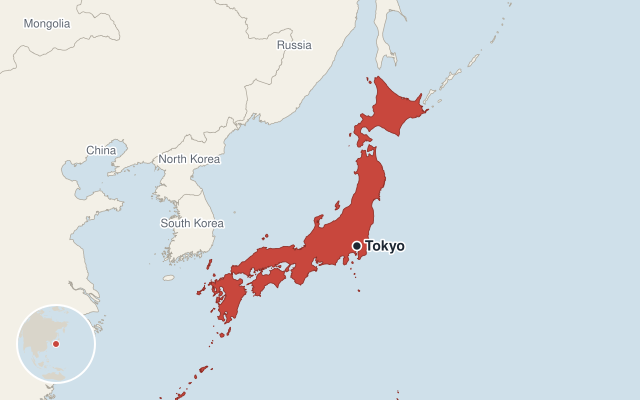
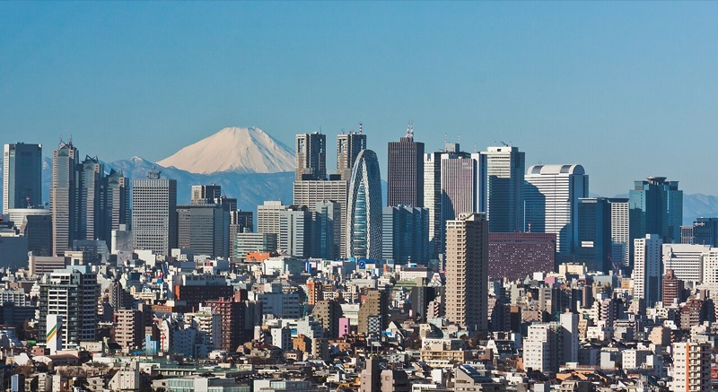

---
id    = "3f55e996-ce41-50ce-b4e0-bc429f7bc9ad"
model = "Basic"
tags  = ["asia", "sovereign_state", "capital"]
---

## Front

What is the capital of <b>Japan</b>?

## Back

<b>Tokyo</b>

## Extra

<i>Photo: Morio, CC BY-SA 3.0, via Wikimedia Commons</i>

About 14.3 million people (2022) in the metropolis Greater Tokyo has 33 million (2025)

Originally Edo, it rose to prominence in 1603 as seat of the Tokugawa shogunate. After the Meiji Restoration of 1868 the capital moved from Kyoto and the city was renamed Tokyo, 'Eastern Capital'.

<a href="https://en.wikipedia.org/wiki/Tokyo">Tokyo on Wikipedia</a> <a href="https://en.wikipedia.org/wiki/Japan">Japan on Wikipedia</a>
