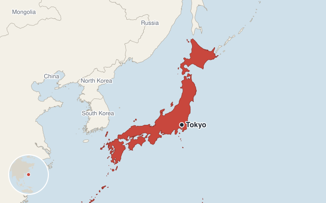
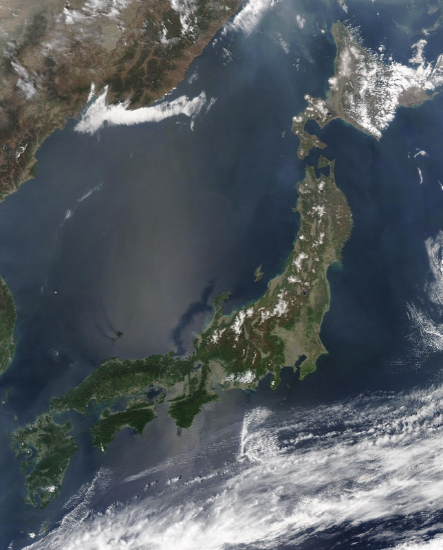

---
id    = "35613fa4-4b09-5a89-b41c-e3ebd6763f5e"
model = "Basic"
tags  = ["asia", "sovereign_state", "country"]
---

## Front

<b>Tokyo</b> is the capital of which country or territory?

## Back

<b>Japan</b>

## Extra

<i>Photo: Jeff Schmaltz, MODIS Rapid Response Team, NASA/GSFC, Public domain, via Wikimedia Commons</i>

About 124 million people (2024), the world's 11th most populous Four major islands and over 14,000 smaller ones

Sometimes called the Land of the Rising Sun. About 75% of its terrain is mountainous and heavily forested, so most people live on the eastern coastal plains.

<a href="https://en.wikipedia.org/wiki/Japan">Japan on Wikipedia</a> <a href="https://en.wikipedia.org/wiki/Tokyo">Tokyo on Wikipedia</a>
