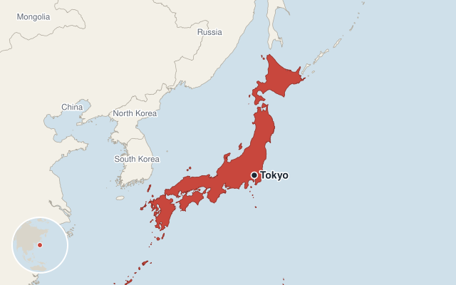

---
id    = "f81d1bc3-3d62-5d4c-aa96-af1b54888b95"
model = "Basic"
tags  = ["asia", "sovereign_state", "flag"]
---

## Front

Whose flag is this?

## Back

<b>Japan</b>

## Extra

<a href="https://en.wikipedia.org/wiki/Flag_of_Japan">Flag of Japan on Wikipedia</a> <a href="https://en.wikipedia.org/wiki/Japan">Japan on Wikipedia</a>
