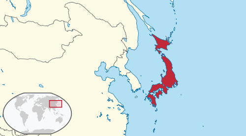
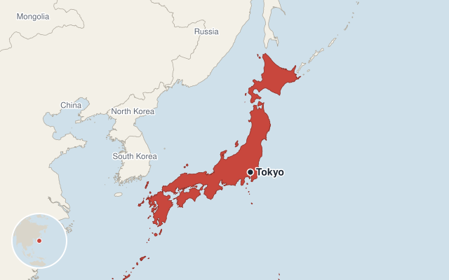

---
id    = "dd6442e2-9fa2-5a43-97eb-687a8f242f41"
model = "Basic"
tags  = ["asia", "sovereign_state", "map"]
---

## Front

What is highlighted on this map?

## Back

<b>Japan</b>

## Extra

Highest point is Mount Fuji Sea of Japan to the west, Sea of Okhotsk in the north, East China Sea in the south

An archipelago in the Pacific Ocean off the northeast coast of the mainland. Four major islands sit among over 14,000 smaller ones.

<a href="https://en.wikipedia.org/wiki/Japan">Japan on Wikipedia</a>
