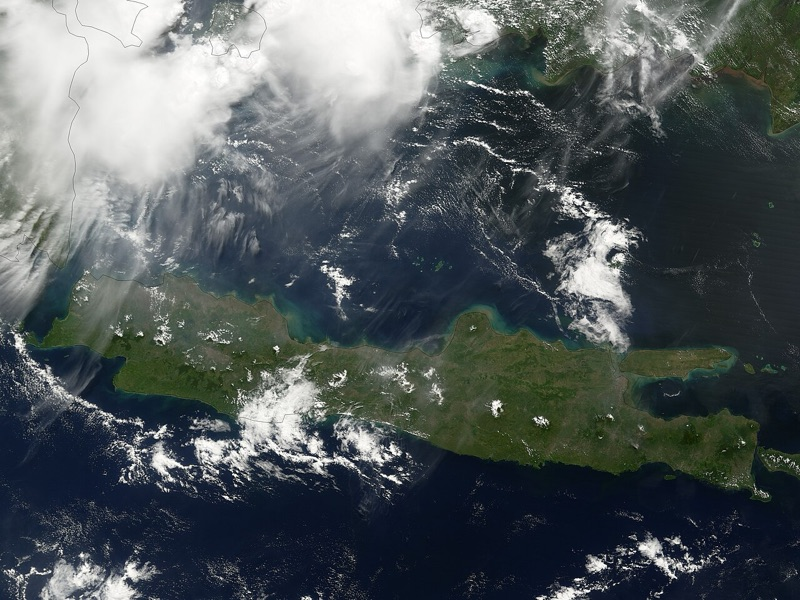

---
id    = "d502b0ac-8db1-58c2-9e60-faacd7b63cf6"
model = "Basic"
tags  = ["asia", "map"]
---

## Front

What is highlighted on this map?

## Back

<b>Java</b>

## Extra

<i>Photo: NASA, Public domain, via Wikimedia Commons</i>

About 160 million people (2015), the world's most populous island Jakarta is on its northwestern coast

A chain of volcanic mountains forms the island's east-west spine. It holds about 56% of Indonesia's people on only 7% of its land.

Island of Indonesia.

<a href="https://en.wikipedia.org/wiki/Java">Java on Wikipedia</a>
