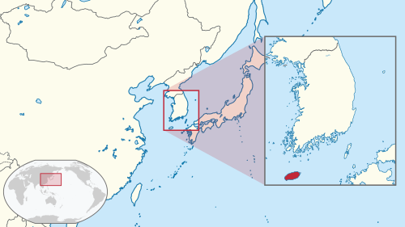

---
id    = "53571403-22cc-541a-96a3-f0690bda2a7f"
model = "Basic"
tags  = ["asia", "map"]
---

## Front

What is highlighted on this map?

## Back

<b>Jeju</b>

## Extra

<i>Photo: Yongchangjang at English Wikipedia, Yongchangjang at English Wikipedia, via Wikimedia Commons</i>

About 671,000 people (2024) in 1,848 km² Highest point is Hallasan, 1,950 m

The southernmost province of South Korea. Its main island, South Korea's largest, is home to the shield volcano Hallasan.

Autonomous province of South Korea.

<a href="https://en.wikipedia.org/wiki/Jeju_Province">Jeju Province on Wikipedia</a>
