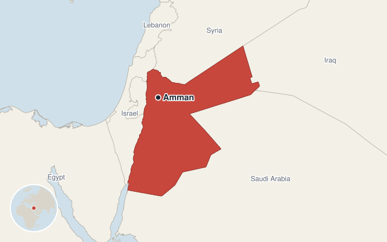

---
id    = "68d2586a-1830-5472-9a44-ffdaa1c63e37"
model = "Basic"
tags  = ["asia", "middle_east", "sovereign_state", "capital"]
---

## Front

What is the capital of <b>Jordan</b>?

## Back

<b>Amman</b>

## Extra

About 4 million people (2015) 776 m above sea level

Built on seven hills at first, it now spans over 19. It was Rabbath Ammon, then Philadelphia, and was renamed Amman in the 7th century. It became Transjordan's capital in 1921.

<a href="https://en.wikipedia.org/wiki/Amman">Amman on Wikipedia</a> <a href="https://en.wikipedia.org/wiki/Jordan">Jordan on Wikipedia</a>
