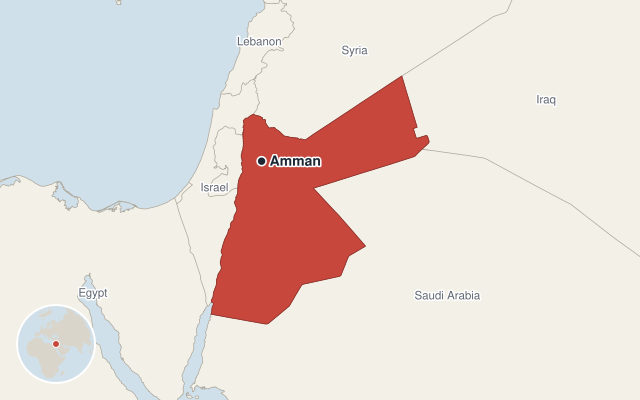

---
id    = "79028fc8-4074-57b4-b5b6-75467bec227c"
model = "Basic"
tags  = ["asia", "middle_east", "sovereign_state", "country"]
---

## Front

<b>Amman</b> is the capital of which country or territory?

## Back

<b>Jordan</b>

## Extra

<a href="https://en.wikipedia.org/wiki/Jordan">Jordan on Wikipedia</a> <a href="https://en.wikipedia.org/wiki/Amman">Amman on Wikipedia</a>
