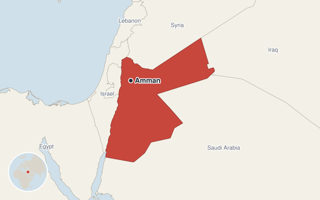

---
id    = "7b05aac4-e060-549c-b50c-0910bc9634b8"
model = "Basic"
tags  = ["asia", "middle_east", "sovereign_state", "flag"]
---

## Front

Whose flag is this?

## Back

<b>Jordan</b>

## Extra

<a href="https://en.wikipedia.org/wiki/Flag_of_Jordan">Flag of Jordan on Wikipedia</a> <a href="https://en.wikipedia.org/wiki/Jordan">Jordan on Wikipedia</a>
