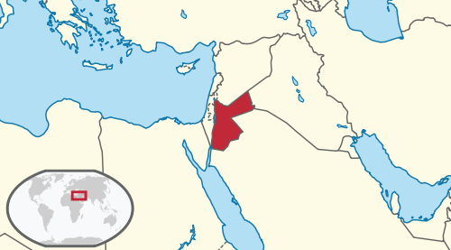
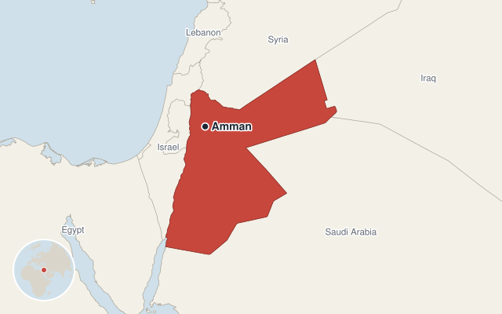
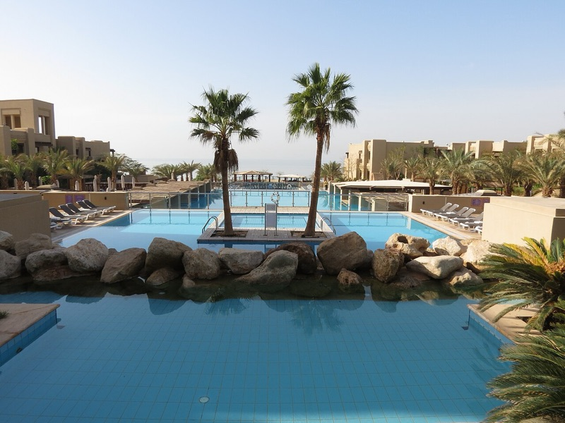

---
id    = "69197c62-99f3-5804-87fb-a0327e6e2b63"
model = "Basic"
tags  = ["asia", "middle_east", "sovereign_state", "map"]
---

## Front

What is highlighted on this map?

## Back

<b>Jordan</b>

## Extra

<i>Photo: xorge, CC BY-SA 2.0, via Wikimedia Commons</i>

Borders Syria, Iraq, Saudi Arabia and Israel Highest point is Jabal Umm ad Dami

A small coastline on the Red Sea in the southwest, separated from Egypt by the Gulf of Aqaba. The Jordan River flows into the Dead Sea along the western border, in the Jordan Rift Valley.

<a href="https://en.wikipedia.org/wiki/Jordan">Jordan on Wikipedia</a>
