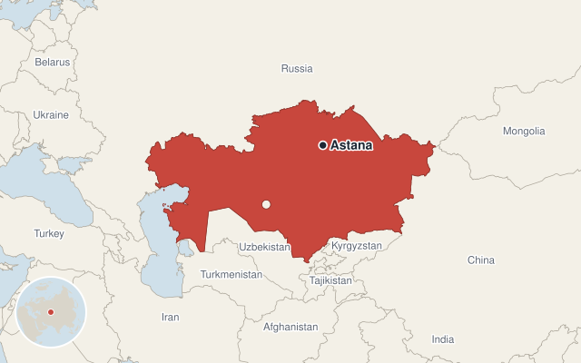
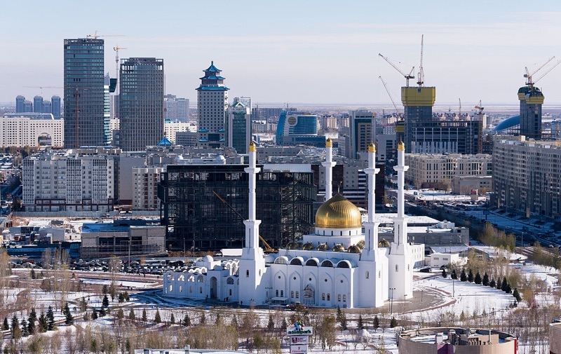

---
id    = "6a6ace9f-eeb3-5045-be2b-51987a442c48"
model = "Basic"
tags  = ["asia", "sovereign_state", "capital"]
---

## Front

What is the capital of <b>Kazakhstan</b>?

## Back

<b>Astana</b>

## Extra

<i>Photo: Mos.ru, Денис Гришкин, via Wikimedia Commons</i>

About 1.7 million people within the city limits On the Ishim river, in the north of the country

Founded as Aqmoly in 1830, then Akmolinsk, Tselinograd and Aqmola. It became Astana, 'capital' in Kazakh, in 1998. As Nur-Sultan from 2019, it reverted to Astana in 2022.

Known as Nur-Sultan between 2019 and 2022.

<a href="https://en.wikipedia.org/wiki/Astana">Astana on Wikipedia</a> <a href="https://en.wikipedia.org/wiki/Kazakhstan">Kazakhstan on Wikipedia</a>
