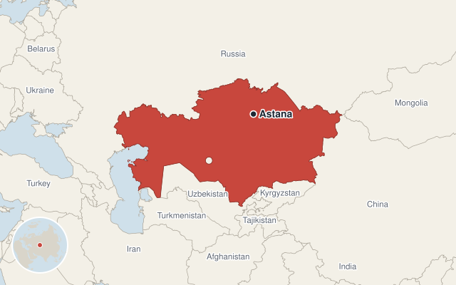

---
id    = "883b5951-7cc6-5845-8c5f-ec4768b4c3fc"
model = "Basic"
tags  = ["asia", "sovereign_state", "country"]
---

## Front

<b>Astana</b> is the capital of which country or territory?

## Back

<b>Kazakhstan</b>

## Extra

About 20.1 million people (2024) in 2.72 million km² The world's ninth-largest country by area

The largest landlocked country. Almaty was the capital until 1997.

Known as Nur-Sultan between 2019 and 2022.

<a href="https://en.wikipedia.org/wiki/Kazakhstan">Kazakhstan on Wikipedia</a> <a href="https://en.wikipedia.org/wiki/Astana">Astana on Wikipedia</a>
