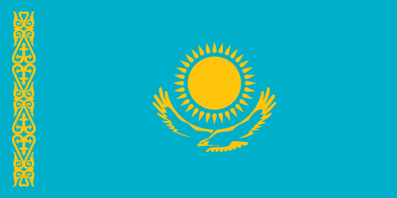
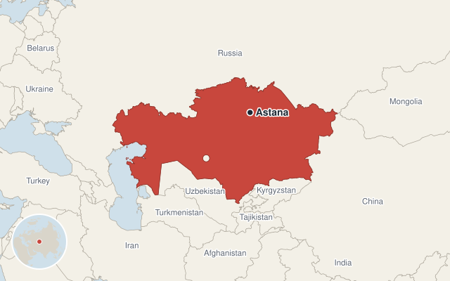

---
id    = "7425ed78-300b-510d-b75a-7aea7c4a1a31"
model = "Basic"
tags  = ["asia", "sovereign_state", "flag"]
---

## Front

Whose flag is this?

## Back

<b>Kazakhstan</b>

## Extra

Adopted on 4 June 1992

A turquoise banner with a 32-ray golden sun above a soaring steppe eagle. A national ornamental pattern, qoshqar-muiiz, runs down the hoist side.

<a href="https://en.wikipedia.org/wiki/Flag_of_Kazakhstan">Flag of Kazakhstan on Wikipedia</a> <a href="https://en.wikipedia.org/wiki/Kazakhstan">Kazakhstan on Wikipedia</a>
