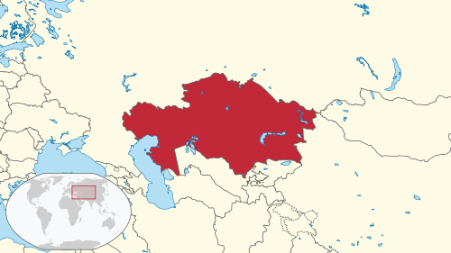
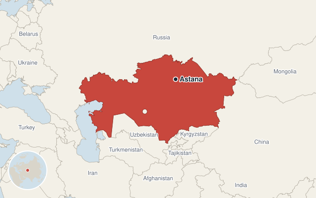

---
id    = "5ec8196b-cd63-5d2d-b8fa-be6eb23ffdef"
model = "Basic"
tags  = ["asia", "sovereign_state", "map"]
---

## Front

What is highlighted on this map?

## Back

<b>Kazakhstan</b>

## Extra

Borders Russia, China, Kyrgyzstan, Uzbekistan and Turkmenistan Highest point is Khan Tengri

Primarily in Central Asia, with a portion extending into Eastern Europe, and a coastline along the Caspian Sea.

<a href="https://en.wikipedia.org/wiki/Kazakhstan">Kazakhstan on Wikipedia</a>
