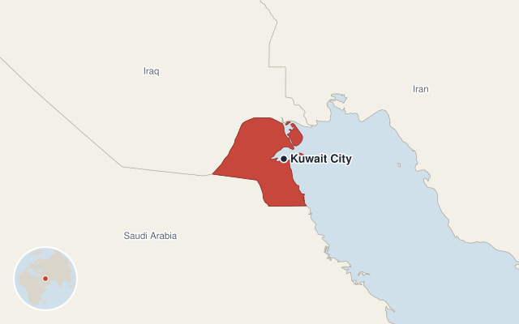

---
id    = "b803860a-dd07-5f29-983b-abab4747f485"
model = "Basic"
tags  = ["asia", "middle_east", "sovereign_state", "capital"]
---

## Front

What is the capital of <b>Kuwait</b>?

## Back

<b>Kuwait City</b>

## Extra

About 3 million people (2018) 16 m above sea level, on the south shore of Kuwait Bay

The political, cultural and economic centre of the emirate, home to the headquarters of most Kuwaiti corporations and its entire banking system.

<a href="https://en.wikipedia.org/wiki/Kuwait_City">Kuwait City on Wikipedia</a> <a href="https://en.wikipedia.org/wiki/Kuwait">Kuwait on Wikipedia</a>
