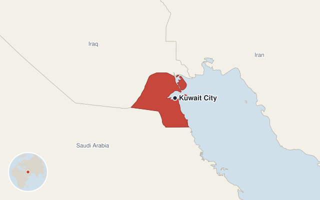

---
id    = "aa343e4d-f29b-5eff-b440-ca2b07934dcf"
model = "Basic"
tags  = ["asia", "middle_east", "sovereign_state", "country"]
---

## Front

<b>Kuwait City</b> is the capital of which country or territory?

## Back

<b>Kuwait</b>

## Extra

<a href="https://en.wikipedia.org/wiki/Kuwait">Kuwait on Wikipedia</a> <a href="https://en.wikipedia.org/wiki/Kuwait_City">Kuwait City on Wikipedia</a>
