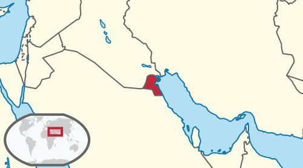
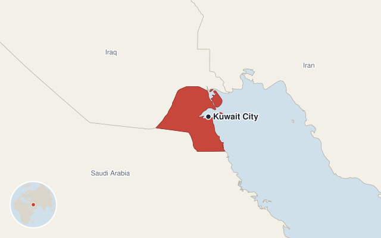

---
id    = "6e2cfc99-7e6f-586a-ae72-516af2d80b4f"
model = "Basic"
tags  = ["asia", "middle_east", "sovereign_state", "map"]
---

## Front

What is highlighted on this map?

## Back

<b>Kuwait</b>

## Extra

<a href="https://en.wikipedia.org/wiki/Kuwait">Kuwait on Wikipedia</a>
