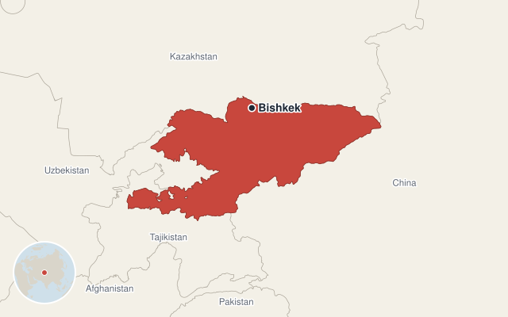

---
id    = "eb919a4a-ced1-5b32-a635-e775e042dff7"
model = "Basic"
tags  = ["asia", "sovereign_state", "capital"]
---

## Front

What is the capital of <b>Kyrgyzstan</b>?

## Back

<b>Bishkek</b>

## Extra

<a href="https://en.wikipedia.org/wiki/Bishkek">Bishkek on Wikipedia</a> <a href="https://en.wikipedia.org/wiki/Kyrgyzstan">Kyrgyzstan on Wikipedia</a>
