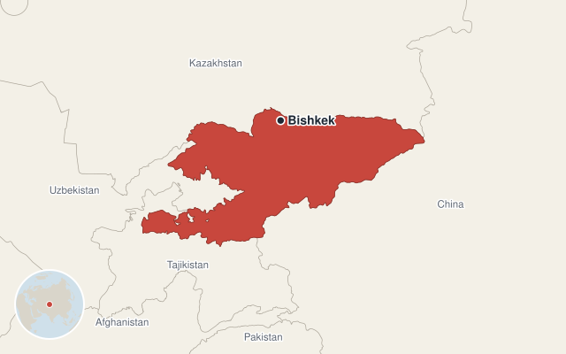

---
id    = "5fce8069-11be-53a1-89cd-36ab9f057e97"
model = "Basic"
tags  = ["asia", "sovereign_state", "country"]
---

## Front

<b>Bishkek</b> is the capital of which country or territory?

## Back

<b>Kyrgyzstan</b>

## Extra

<a href="https://en.wikipedia.org/wiki/Kyrgyzstan">Kyrgyzstan on Wikipedia</a> <a href="https://en.wikipedia.org/wiki/Bishkek">Bishkek on Wikipedia</a>
