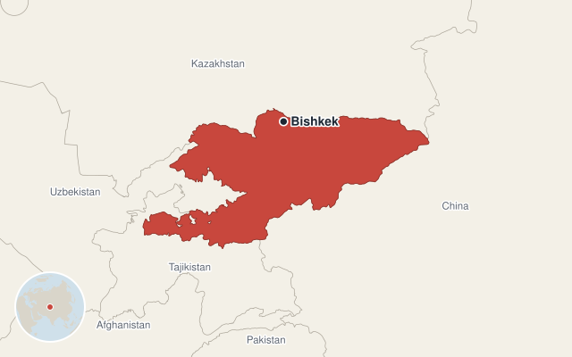

---
id    = "2005153d-d88a-5aac-85b5-d6110bee564f"
model = "Basic"
tags  = ["asia", "sovereign_state", "flag"]
---

## Front

Whose flag is this?

## Back

<b>Kyrgyzstan</b>

## Extra

<a href="https://en.wikipedia.org/wiki/Flag_of_Kyrgyzstan">Flag of Kyrgyzstan on Wikipedia</a> <a href="https://en.wikipedia.org/wiki/Kyrgyzstan">Kyrgyzstan on Wikipedia</a>
