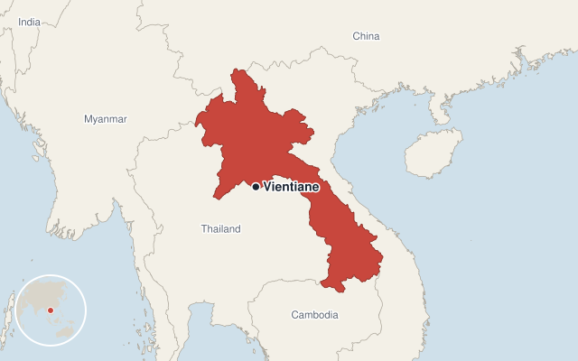

---
id    = "969e6e84-c55a-54f6-b2d7-ec4c58518029"
model = "Basic"
tags  = ["asia", "southeast_asia", "sovereign_state", "capital"]
---

## Front

What is the capital of <b>Laos</b>?

## Back

<b>Vientiane</b>

## Extra

<a href="https://en.wikipedia.org/wiki/Vientiane">Vientiane on Wikipedia</a> <a href="https://en.wikipedia.org/wiki/Laos">Laos on Wikipedia</a>
