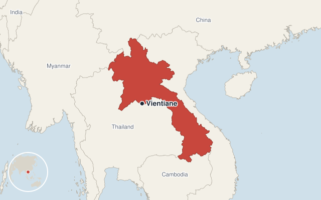

---
id    = "87971e9b-5e40-5de7-8525-a6ad14040961"
model = "Basic"
tags  = ["asia", "southeast_asia", "sovereign_state", "country"]
---

## Front

<b>Vientiane</b> is the capital of which country or territory?

## Back

<b>Laos</b>

## Extra

<a href="https://en.wikipedia.org/wiki/Laos">Laos on Wikipedia</a> <a href="https://en.wikipedia.org/wiki/Vientiane">Vientiane on Wikipedia</a>
