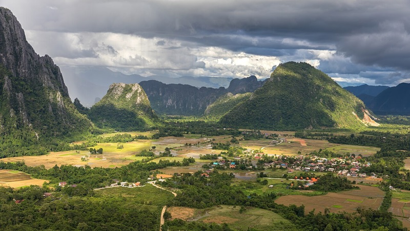

---
id    = "e2a4903d-2928-506f-a926-0eac83f4d8c0"
model = "Basic"
tags  = ["asia", "southeast_asia", "sovereign_state", "map"]
---

## Front

What is highlighted on this map?

## Back

<b>Laos</b>

## Extra

<i>Photo: Basile Morin, CC BY-SA 4.0, via Wikimedia Commons</i>

Borders Myanmar, China, Vietnam, Cambodia and Thailand

Landlocked, with Vietnam to the east and Thailand to the west and southwest. The Mekong runs along the border with Thailand near the capital.

<a href="https://en.wikipedia.org/wiki/Laos">Laos on Wikipedia</a>
