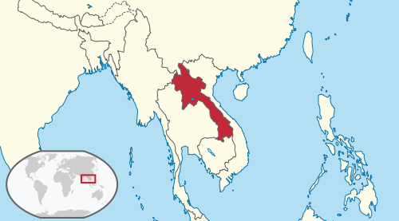
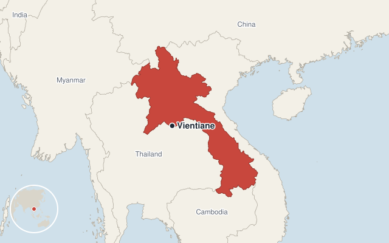

---
id    = "e2a4903d-2928-506f-a926-0eac83f4d8c0"
model = "Basic"
tags  = ["asia", "southeast_asia", "sovereign_state", "map"]
---

## Front

What is highlighted on this map?

## Back

<b>Laos</b>

## Extra

<a href="https://en.wikipedia.org/wiki/Laos">Laos on Wikipedia</a>
