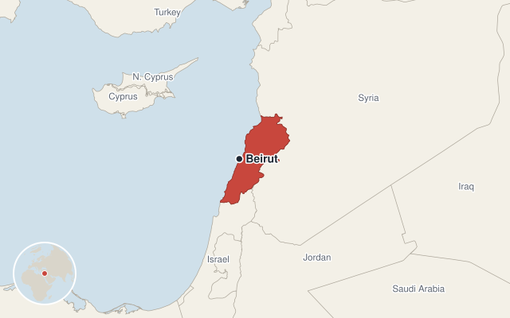

---
id    = "f300d579-7fed-5c0d-b492-232787c8a71a"
model = "Basic"
tags  = ["asia", "mediterranean", "middle_east", "sovereign_state", "capital"]
---

## Front

What is the capital of <b>Lebanon</b>?

## Back

<b>Beirut</b>

## Extra

<a href="https://en.wikipedia.org/wiki/Beirut">Beirut on Wikipedia</a> <a href="https://en.wikipedia.org/wiki/Lebanon">Lebanon on Wikipedia</a>
