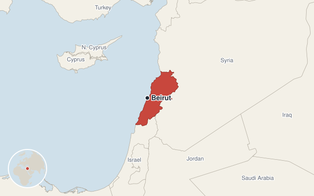
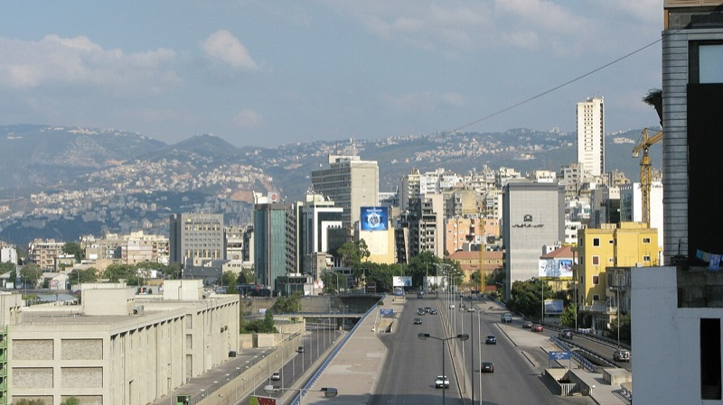

---
id    = "a25987da-0235-5366-a641-b574914baac9"
model = "Basic"
tags  = ["asia", "mediterranean", "middle_east", "sovereign_state", "country"]
---

## Front

<b>Beirut</b> is the capital of which country or territory?

## Back

<b>Lebanon</b>

## Extra

<i>Photo: © Vyacheslav Argenberg / http://www.vascoplanet.com/, Vyacheslav Argenberg, via Wikimedia Commons</i>

About 5.3 million people (2026) in 10,452 km² Highest point is Qurnat as Sawda'

From 3200 to 539 BC it was part of Phoenicia, a maritime civilization that spanned the Mediterranean Basin.

<a href="https://en.wikipedia.org/wiki/Lebanon">Lebanon on Wikipedia</a> <a href="https://en.wikipedia.org/wiki/Beirut">Beirut on Wikipedia</a>
