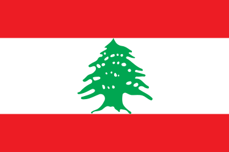
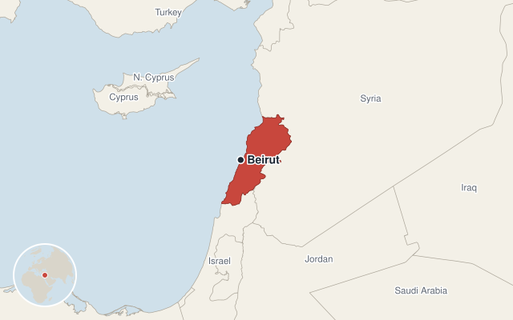

---
id    = "c271f826-a76b-564a-bbce-4241c9b8756e"
model = "Basic"
tags  = ["asia", "mediterranean", "middle_east", "sovereign_state", "flag"]
---

## Front

Whose flag is this?

## Back

<b>Lebanon</b>

## Extra

<a href="https://en.wikipedia.org/wiki/Flag_of_Lebanon">Flag of Lebanon on Wikipedia</a> <a href="https://en.wikipedia.org/wiki/Lebanon">Lebanon on Wikipedia</a>
