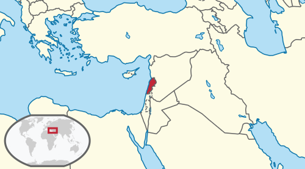
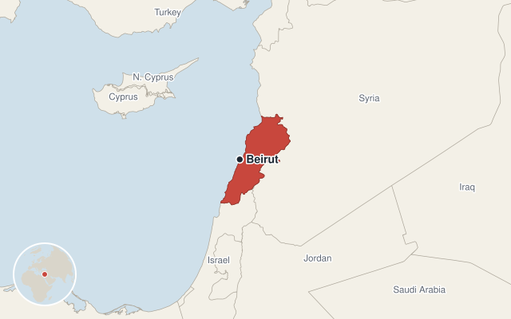

---
id    = "bbabe2fc-0cc2-54c4-a74b-9e1a5fee8a26"
model = "Basic"
tags  = ["asia", "mediterranean", "middle_east", "sovereign_state", "map"]
---

## Front

What is highlighted on this map?

## Back

<b>Lebanon</b>

## Extra

Borders Syria to the north and east, Israel to the south Highest point is Qurnat as Sawda'

It has a Mediterranean coast on the west, with Cyprus a short distance from the shore.

<a href="https://en.wikipedia.org/wiki/Lebanon">Lebanon on Wikipedia</a>
