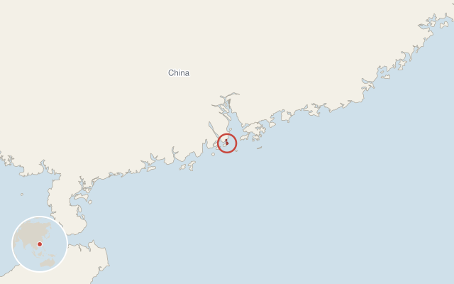

---
id    = "022649c0-612b-5351-97c5-9ee7a8c4187b"
model = "Basic"
tags  = ["asia", "flag"]
---

## Front

Whose flag is this?

## Back

<b>Macau</b>

## Extra

Special Administrative Region of China.

<a href="https://en.wikipedia.org/wiki/Flag_of_Macau">Flag of Macau on Wikipedia</a> <a href="https://en.wikipedia.org/wiki/Macau">Macau on Wikipedia</a>
