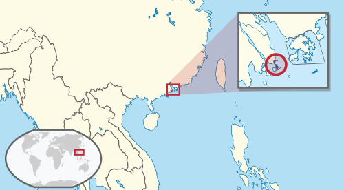
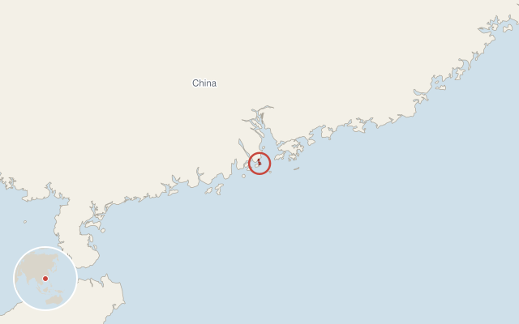
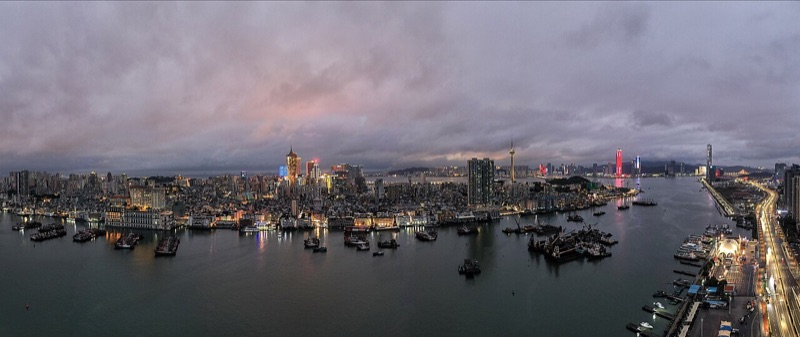

---
id    = "a487f3d7-0a6b-561a-b52d-45b42cf5f918"
model = "Basic"
tags  = ["asia", "map"]
---

## Front

What is highlighted on this map?

## Back

<b>Macau</b>

## Extra

<i>Photo: Charlie fong, CC BY-SA 4.0, via Wikimedia Commons</i>

Made up of the Macau Peninsula and the islands of Taipa and Coloane About 118 km² in total

The Cotai reclamation zone joins Taipa and Coloane, and two-thirds of the territory's area is built on land reclaimed from the sea.

Special Administrative Region of China.

<a href="https://en.wikipedia.org/wiki/Macau">Macau on Wikipedia</a>
