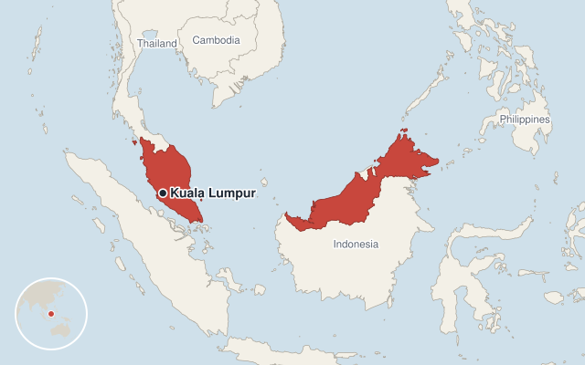

---
id    = "35631aa0-9d5a-5aa0-a60d-97167a2aab27"
model = "Basic"
tags  = ["asia", "southeast_asia", "sovereign_state", "capital"]
---

## Front

What is the capital of <b>Malaysia</b>?

## Back

<b>Kuala Lumpur</b>

## Extra

<a href="https://en.wikipedia.org/wiki/Kuala_Lumpur">Kuala Lumpur on Wikipedia</a> <a href="https://en.wikipedia.org/wiki/Malaysia">Malaysia on Wikipedia</a>
