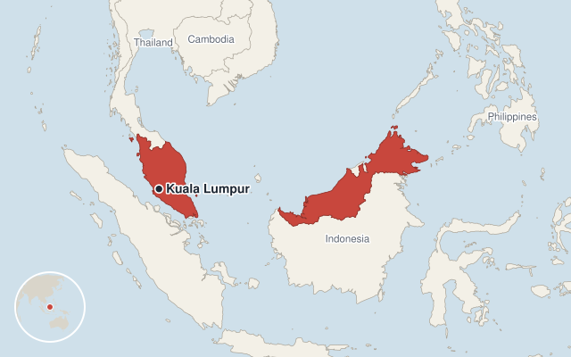

---
id    = "9cba5219-0752-5e88-b24c-9001906671b6"
model = "Basic"
tags  = ["asia", "southeast_asia", "sovereign_state", "country"]
---

## Front

<b>Kuala Lumpur</b> is the capital of which country or territory?

## Back

<b>Malaysia</b>

## Extra

About 34 million people (2025) 330,803 km²

The South China Sea splits it in two: Peninsular Malaysia on the mainland and East Malaysia on the island of Borneo. Putrajaya is the federal administrative capital.

<a href="https://en.wikipedia.org/wiki/Malaysia">Malaysia on Wikipedia</a> <a href="https://en.wikipedia.org/wiki/Kuala_Lumpur">Kuala Lumpur on Wikipedia</a>
