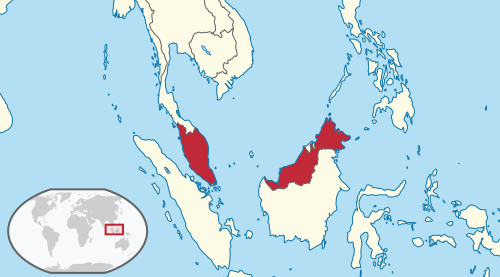
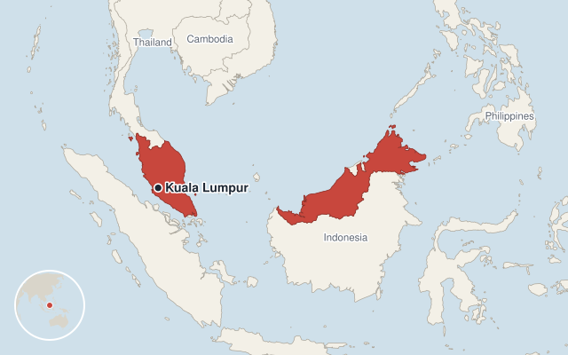

---
id    = "de0d3b98-ca6c-5f17-9534-01b280c892d3"
model = "Basic"
tags  = ["asia", "southeast_asia", "sovereign_state", "map"]
---

## Front

What is highlighted on this map?

## Back

<b>Malaysia</b>

## Extra

<a href="https://en.wikipedia.org/wiki/Malaysia">Malaysia on Wikipedia</a>
