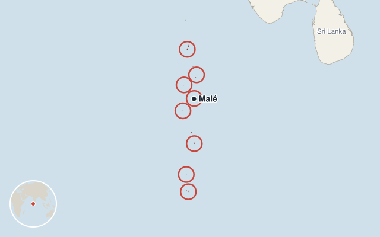

---
id    = "cd444828-1bb0-593d-8083-2a4d4de4491f"
model = "Basic"
tags  = ["asia", "sovereign_state", "capital"]
---

## Front

What is the capital of <b>Maldives</b>?

## Back

<b>Malé</b>

## Extra

About 212,000 people (2022) in an area of 1.9 km² Built on a central island, with the airport on neighbouring Hulhulé

Traditionally called the King's Island, it was where the ancient royal dynasties ruled. The whole country is named after it: "Maldives" means "the islands (dives) of Malé".

<a href="https://en.wikipedia.org/wiki/Mal%C3%A9">Malé on Wikipedia</a> <a href="https://en.wikipedia.org/wiki/Maldives">Maldives on Wikipedia</a>
