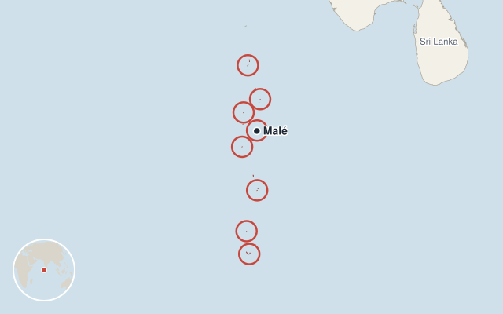

---
id    = "b81902fb-82dd-5a68-b08b-37ff4ecbac79"
model = "Basic"
tags  = ["asia", "sovereign_state", "country"]
---

## Front

<b>Malé</b> is the capital of which country or territory?

## Back

<b>Maldives</b>

## Extra

<a href="https://en.wikipedia.org/wiki/Maldives">Maldives on Wikipedia</a> <a href="https://en.wikipedia.org/wiki/Mal%C3%A9">Malé on Wikipedia</a>
