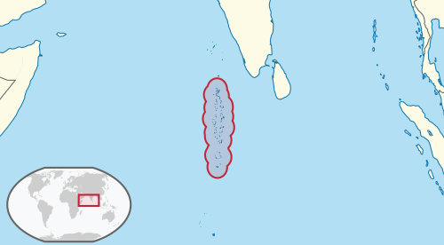
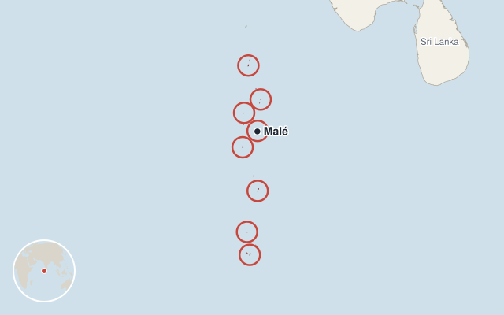

---
id    = "449676ac-0270-5a52-8a3e-9ddbc001ca4e"
model = "Basic"
tags  = ["asia", "sovereign_state", "map"]
---

## Front

What is highlighted on this map?

## Back

<b>Maldives</b>

## Extra

<a href="https://en.wikipedia.org/wiki/Maldives">Maldives on Wikipedia</a>
