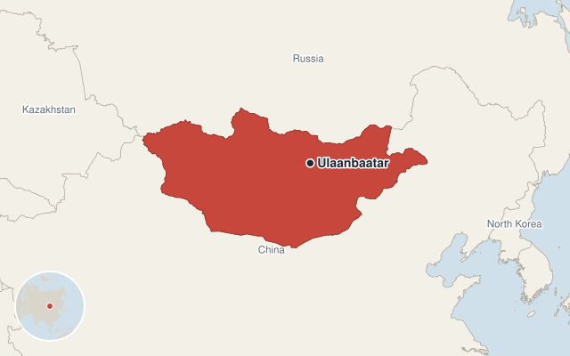

---
id    = "875b93a7-f75a-5d19-ad01-0e1ebc470e2e"
model = "Basic"
tags  = ["asia", "sovereign_state", "capital"]
---

## Front

What is the capital of <b>Mongolia</b>?

## Back

<b>Ulaanbaatar</b>

## Extra

<a href="https://en.wikipedia.org/wiki/Ulaanbaatar">Ulaanbaatar on Wikipedia</a> <a href="https://en.wikipedia.org/wiki/Mongolia">Mongolia on Wikipedia</a>
