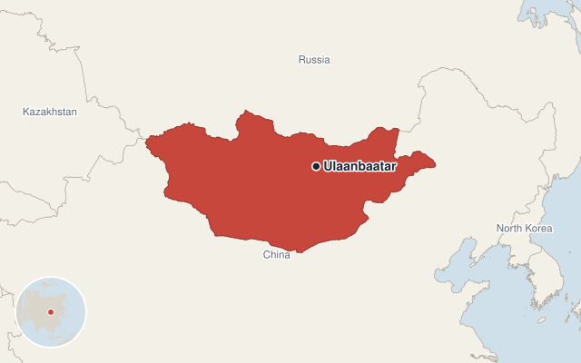
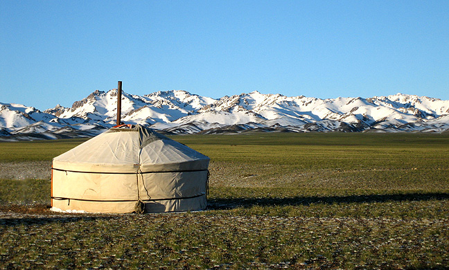

---
id    = "9e5558d6-c9dd-54ae-9bef-f5fb2d48960d"
model = "Basic"
tags  = ["asia", "sovereign_state", "country"]
---

## Front

<b>Ulaanbaatar</b> is the capital of which country or territory?

## Back

<b>Mongolia</b>

## Extra

<i>Photo: Adagio at English Wikipedia, CC BY-SA 3.0, via Wikimedia Commons</i>

About 3.4 million people (2021) in 1.56 million km² Borders only Russia and China

The most sparsely populated sovereign state. Roughly half of Mongolians live in Ulaanbaatar, the world's coldest capital, with a yearly average of −1.3 °C.

<a href="https://en.wikipedia.org/wiki/Mongolia">Mongolia on Wikipedia</a> <a href="https://en.wikipedia.org/wiki/Ulaanbaatar">Ulaanbaatar on Wikipedia</a>
